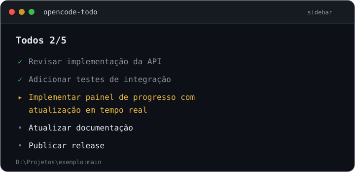

# opencode-todo

[Português](README.md) · [English](README.en.md) · [Español](README.es.md) · [Français](README.fr.md) · [Italiano](README.it.md) · [Русский](README.ru.md) · [हिन्दी](README.hi.md) · [中文](README.zh.md) · [日本語](README.ja.md)

适用于 [OpenCode](https://opencode.ai) 的插件，提供按会话划分的任务列表。代理通过 `todo_write` 和 `todo_list` 工具创建和更新列表项；TUI 会在侧边栏中显示进度，并通过 `/todos` 打开面板。



## 功能

- 按会话保存列表，并持久化到 OpenCode 存储中。
- 子代理会更新根会话的列表。
- 通过 RPC 实时更新。
- 各状态使用不同的图标和颜色，并在换行时保持对齐。
- 通过 `/todos` 面板查看和清空列表。

## 安装

将仓库克隆到 OpenCode 的插件目录，并安装依赖：

```bash
git clone https://github.com/juliano340/opencode-todo.git ~/.config/opencode/plugins/opencode-todo
cd ~/.config/opencode/plugins/opencode-todo
npm install
```

在 Windows 上，请使用等效目录，例如：

```powershell
git clone https://github.com/juliano340/opencode-todo.git "$env:USERPROFILE\.config\opencode\plugins\opencode-todo"
cd "$env:USERPROFILE\.config\opencode\plugins\opencode-todo"
npm install
```

将该文件夹的绝对路径添加到全局 `opencode.json` 的 `plugins` 中：

```jsonc
{
  "plugins": [
    "C:/Users/<usuario>/.config/opencode/plugins/opencode-todo"
  ]
}
```

重新加载 OpenCode 或使用 `/reload`。如果侧边栏没有自动更新，请再次运行 `/reload`。

## 使用

代理在工作期间会自动维护列表。你也可以：

- 使用 `/todos` 打开面板。
- 按 `c` 清空列表，操作前会请求确认。
- 按 `Esc` 关闭面板。

### 状态

| 状态 | 图标 | 外观 |
| --- | --- | --- |
| `pending` | `•` | 中性标记，普通文本 |
| `in_progress` | `▸` | 标记和文本使用主题的警告色 |
| `completed` | `✓` | 标记使用成功色，文本变暗 |

较长的文本会在标题下方换行，不会回到图标所在的列。

## 行为

- 数据存储在 `todos/<sessionID>` 中，重启后仍然保留。
- 当子代理写入时，列表会保存到根会话，以显示在主侧边栏中。
- 更新时，标题相同的列表项会保留原有 `id`。
- 当所有列表项都完成后，下一次提示会清空列表，以仅显示当前任务。
- TUI 通过 RPC（`todo.list`）读取列表，并监听 `todo.changed` 事件。

## 面向模型的工具

### `todo_write`

替换整个列表。请始终发送所有列表项，而不仅仅是变更的部分。

```json
{
  "todos": [
    { "title": "实现端点", "status": "completed" },
    { "title": "验证集成", "status": "in_progress" },
    { "title": "发布版本", "status": "pending" }
  ]
}
```

### `todo_list`

读取当前会话的列表。

## 结构

| 文件 | 职责 |
| --- | --- |
| `src/rpc.ts` | RPC 契约：`todo.list`、`todo.clear` 和 `todo.changed` 事件 |
| `src/index.ts` | 工具、存储、RPC 和自动清理 |
| `src/tui.tsx` | 侧边栏区块和 `/todos` 面板 |

## 开发

```bash
npm install
npx tsc --noEmit
```

要求：OpenCode TUI 插件 API，以及与 Bun 兼容的运行时，详见 `package.json`。

## 许可证

[MIT](LICENSE) © 2026 Juliano Pereira.
